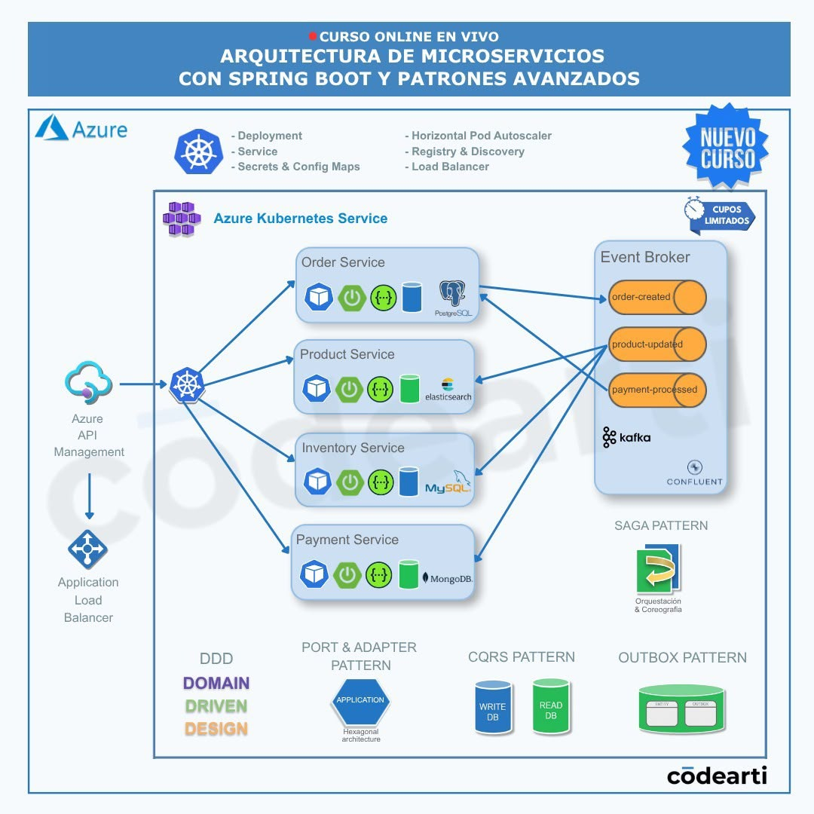
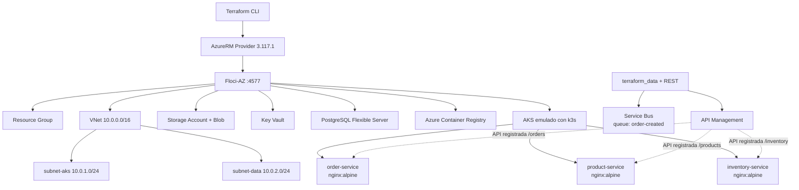
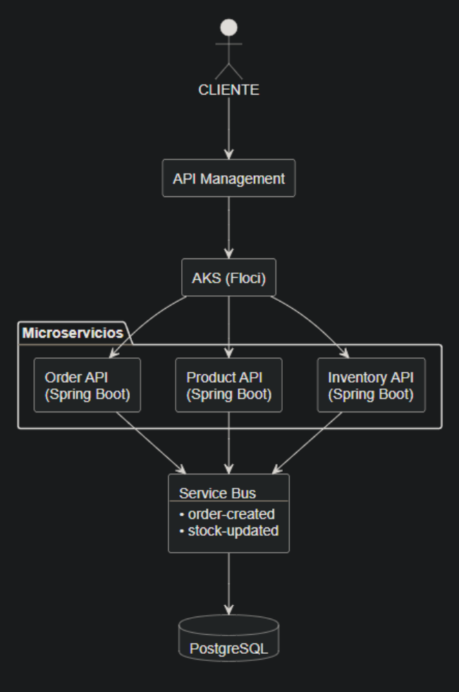
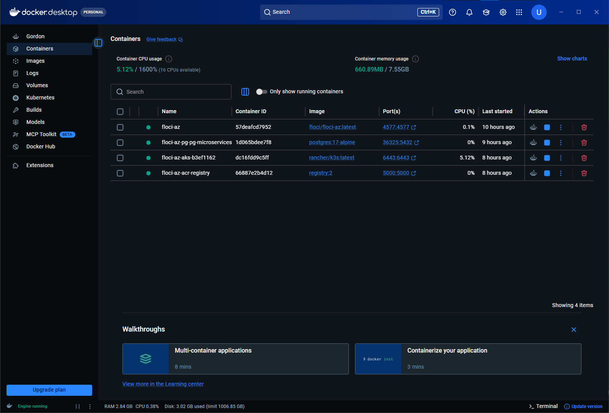
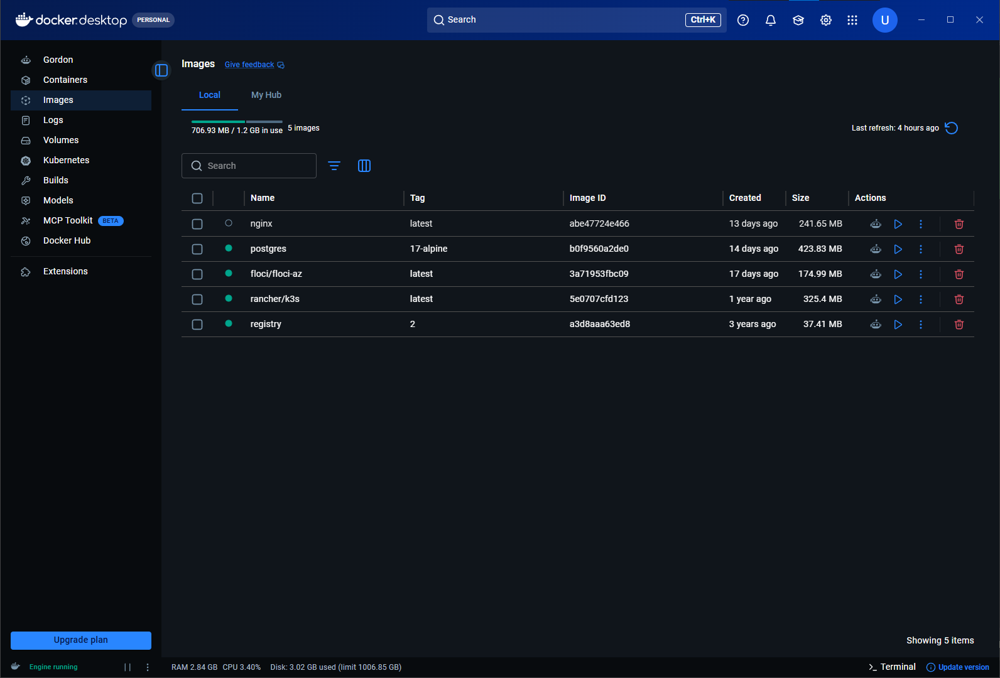

# Terraform + Floci-AZ — Local Azure Microservices Infrastructure Lab


Laboratorio de infraestructura como código orientado a **Azure, Terraform, Docker y Kubernetes**, ejecutado completamente en local mediante **Floci-AZ**.

El objetivo del proyecto fue reproducir una arquitectura de microservicios inspirada en servicios Azure, pero sin depender de una suscripción cloud real ni generar costos. Durante el desarrollo también se documentaron y resolvieron diferencias de compatibilidad entre el provider `azurerm` y el emulador local.

> [!IMPORTANT]
> Este repositorio representa un **laboratorio técnico / proyecto de portafolio**. No pretende replicar al 100 % el comportamiento de Azure real ni presentar una configuración lista para producción.

---

## Arquitectura de referencia

La siguiente imagen fue utilizada como **referencia conceptual inicial** para definir el alcance del laboratorio. No representa de forma exacta la implementación final y no es autoría de este repositorio.

<p align="center">
  
</p>

A partir de esa referencia se construyó una versión local, reducida y reproducible enfocada en infraestructura, integración de servicios y resolución de problemas reales de emulación.

---

## Arquitectura implementada



> [!NOTE]
> Las tres APIs de APIM están registradas en el emulador, pero actualmente **no poseen `service_url` hacia los `ClusterIP` internos de k3s**. El diagrama muestra la relación conceptual; no debe interpretarse como un enrutamiento end-to-end ya configurado.

---

## Alcance final

| Área | Recurso | Implementación |
|---|---|---|
| Resource Group | `rg-microservices-local` | AzureRM + Floci-AZ |
| Networking | `vnet-microservices-local` | `10.0.0.0/16` |
| Networking | `subnet-aks` | `10.0.1.0/24` |
| Networking | `subnet-data` | `10.0.2.0/24` |
| Storage | `stmicroserviceslocal` | Storage Account Standard / LRS |
| Blob Storage | `microservices` | Container privado |
| Security | `kv-microservices-local` | Key Vault local |
| Messaging | `order-created` | Service Bus mediante REST local |
| Database | `pg-microservices-local` | PostgreSQL Flexible Server emulado |
| Registry | `acrmicroserviceslocal` | ACR respaldado localmente por `registry:2` |
| Kubernetes | `aks-microservices-local` | AKS emulado con k3s |
| Workload | `order-service` | Deployment + ClusterIP Service |
| Workload | `product-service` | Deployment + ClusterIP Service |
| Workload | `inventory-service` | Deployment + ClusterIP Service |
| API Gateway | `apim-microservices-local` | API Management mediante ARM REST |
| API | `/orders` | Orders API |
| API | `/products` | Products API |
| API | `/inventory` | Inventory API |

Los workloads de Kubernetes son **placeholders de infraestructura** basados en `nginx:alpine`; no contienen todavía lógica de negocio Spring Boot. Cada servicio usa una réplica y un `Service` de tipo `ClusterIP`.

---

## Tecnologías

- **Terraform** `>= 1.10.0`
- **HashiCorp AzureRM Provider** `3.117.1`
- **Floci-AZ** como emulador local de Azure
- **Docker Desktop**
- **Kubernetes / k3s**
- **PowerShell**
- **PostgreSQL**
- **Azure Container Registry** emulado mediante `registry:2`
- **Azure Service Bus** emulado localmente
- **Azure API Management** mediante ARM REST
- **Azure Storage / Blob Storage**
- **Azure Key Vault**

---

## Estructura del repositorio

```text
terraform-floci-lab/
│
├── .gitignore
├── README.md
├── roadmap.md
│
├── assets/
│   ├── proyecto-diagrama.png
│   ├── diseño-conceptual.png
│   ├── contenedores-ejecutados.png
│   └── imagenes-locales.png
│
├── services/
│   └── k8s/
│       └── microservices.yaml
│
└── terraform/
    ├── .terraform.lock.hcl
    ├── main.tf
    ├── outputs.tf
    ├── providers.tf
    └── variables.tf
```

Los archivos de estado, runtime local, certificados y claves privadas **no deben versionarse**:

```text
floci-data/
terraform/.terraform/
*.tfstate
*.tfstate.*
*.tfvars
*.key
*.pem
*.pkcs8
*.crt
```

---

# Ejecución del laboratorio

## 1. Requisitos

Se recomienda disponer de:

- Windows 10/11
- Docker Desktop iniciado
- Terraform `>= 1.10.0`
- Floci CLI instalado
- PowerShell
- `kubectl` para validaciones opcionales

Verificaciones rápidas:

```powershell
docker --version
terraform version
floci --version
kubectl version --client
```

---

## 2. Iniciar Floci-AZ

```powershell
floci az start
floci az status
```

El endpoint local utilizado por el proyecto es:

```text
http://127.0.0.1:4577
```

Validación de conectividad:

```powershell
Test-NetConnection 127.0.0.1 -Port 4577
```

Validación del health endpoint:

```powershell
curl.exe -v http://127.0.0.1:4577/health
```

Respuesta observada durante el laboratorio:

```json
{
  "version": "dev",
  "edition": "floci-az-always-free",
  "status": "UP"
}
```

---

## 3. Configurar la contraseña de PostgreSQL

La contraseña del administrador no se almacena en Git. Se inyecta mediante una variable de entorno de Terraform:

```powershell
$env:TF_VAR_postgresql_admin_password = "<TU_PASSWORD_LOCAL>"
```

La variable está declarada como `sensitive = true` en `variables.tf`.

---

## 4. Inicializar Terraform

```powershell
cd .\terraform

terraform init
terraform fmt
terraform validate
terraform plan
```

Si el plan es correcto:

```powershell
terraform apply
```

Confirmar con:

```text
yes
```

---

## 5. Verificar el estado de Terraform

```powershell
terraform state list
terraform output
```

Estado final esperado, de forma aproximada:

```text
azurerm_container_registry.microservices
azurerm_key_vault.microservices
azurerm_kubernetes_cluster.microservices
azurerm_postgresql_flexible_server.microservices
azurerm_resource_group.microservices
azurerm_storage_account.microservices
azurerm_storage_container.microservices
azurerm_subnet.aks
azurerm_subnet.data
azurerm_virtual_network.microservices
terraform_data.api_management
terraform_data.service_bus_queue
```

---

## 6. Desplegar los workloads en Kubernetes

El manifiesto contiene tres `Deployment` y tres `Service`:

- `order-service`
- `product-service`
- `inventory-service`

Como Floci-AZ ejecuta el AKS local mediante un contenedor k3s, primero se obtiene su nombre:

```powershell
$aksContainer = docker ps `
  --filter "name=floci-az-aks-" `
  --format "{{.Names}}" | Select-Object -First 1

$aksContainer
```

Aplicar el manifiesto:

```powershell
Get-Content -Raw ..\services\k8s\microservices.yaml |
  docker exec -i $aksContainer kubectl apply -f -
```

Verificar deployments:

```powershell
docker exec $aksContainer kubectl get deployments
```

Verificar pods:

```powershell
docker exec $aksContainer kubectl get pods
```

Verificar servicios:

```powershell
docker exec $aksContainer kubectl get services
```

El resultado final del laboratorio fue:

```text
order-service       1/1 Running
product-service     1/1 Running
inventory-service   1/1 Running
```

---

## 7. Verificar contenedores locales

```powershell
docker ps
```

Durante la ejecución se observaron contenedores equivalentes a:

```text
floci-az
floci-az-pg-pg-microservices
floci-az-aks-<id>
floci-az-acr-registry
```

Floci utiliza internamente imágenes como:

```text
floci/floci-az:latest
postgres:17-alpine
rancher/k3s:latest
registry:2
```

> Aunque la propiedad ARM/Terraform del laboratorio solicita PostgreSQL 16, la implementación local observada de Floci-AZ utiliza un contenedor `postgres:17-alpine`. Esta diferencia corresponde al emulador, no a una modificación de la versión declarada en Terraform.

---

# Configuración del provider

El provider se conecta a Floci-AZ en lugar de Azure real:

```hcl
provider "azurerm" {
  features {}

  environment   = "stack"
  metadata_host = "localhost:4577"

  subscription_id = "00000000-0000-0000-0000-000000000001"
  tenant_id       = "00000000-0000-0000-0000-000000000002"
  client_id       = "00000000-0000-0000-0000-000000000003"
  client_secret   = "fake-secret"

  use_cli                    = false
  skip_provider_registration = true
}
```

Los IDs y credenciales anteriores son valores ficticios utilizados exclusivamente por el laboratorio local.

---

# Evolución respecto a la arquitectura de referencia

El proyecto **no replica literalmente** la arquitectura de la imagen inicial. El objetivo fue convertirla en un laboratorio alcanzable, reproducible y enfocado en infraestructura.

| Referencia conceptual | Implementación realizada |
|---|---|
| Azure real | Floci-AZ sobre Docker Desktop |
| AKS administrado en Azure | AKS emulado localmente mediante k3s |
| Varios microservicios Spring Boot | 3 workloads placeholder con `nginx:alpine` |
| Order / Product / Inventory / Payment | Order / Product / Inventory |
| Kafka + Confluent | Service Bus local |
| Varios eventos | Queue `order-created` |
| Bases de datos por servicio | PostgreSQL local como servicio de datos representativo |
| API Management real | APIM emulado mediante ARM REST |
| Registry cloud | ACR local respaldado por `registry:2` |
| Configuración cloud completa | VNet + subnets + Storage + Blob + Key Vault + PostgreSQL + ACR + AKS + APIM + Service Bus |
| Patrones DDD, CQRS, Outbox y Saga | Fuera del alcance actual; se mantienen como evolución futura |
| HPA / Load Balancer / Service Discovery | Fuera del alcance actual |

Esta reducción fue intencional: primero se validó la **infraestructura local**, su automatización y los límites del emulador antes de implementar lógica de negocio real.

---

# Workarounds y problemas resueltos

Una de las partes más importantes del laboratorio fue trabajar con diferencias reales entre **AzureRM** y **Floci-AZ**.

## Storage Account

Floci devuelve algunas propiedades de forma diferente al servicio Azure real. Para evitar drift innecesario se ignoran campos específicos:

```hcl
lifecycle {
  ignore_changes = [
    queue_encryption_key_type,
    table_encryption_key_type,
    enable_https_traffic_only,
    min_tls_version
  ]
}
```

---

## AKS

El cluster fue creado correctamente por Floci-AZ y el contenedor k3s llegó a estado funcional, pero el provider `azurerm` permaneció esperando el estado de aprovisionamiento.

Se incorporó el recurso existente al state mediante:

```powershell
terraform import azurerm_kubernetes_cluster.microservices `
  "/subscriptions/00000000-0000-0000-0000-000000000001/resourceGroups/rg-microservices-local/providers/Microsoft.ContainerService/managedClusters/aks-microservices-local"
```

Después del import, las diferencias entre los atributos devueltos por Floci y los esperados por AzureRM producían drift. Para este laboratorio local se optó por:

```hcl
lifecycle {
  ignore_changes = all
}
```

> Este workaround es específico del emulador y **no se propone como patrón para Azure real**.

---

## Azure Container Registry

ACR presentó un comportamiento equivalente: Floci había creado el registry local, pero Terraform no completaba correctamente el polling/update.

Se importó el recurso:

```powershell
terraform import azurerm_container_registry.microservices `
  "/subscriptions/00000000-0000-0000-0000-000000000001/resourceGroups/rg-microservices-local/providers/Microsoft.ContainerRegistry/registries/acrmicroserviceslocal"
```

También se evita el drift del provider en este laboratorio:

```hcl
lifecycle {
  ignore_changes = all
}
```

---

## Service Bus

En lugar de depender del recurso nativo del provider, la queue se administra mediante `terraform_data` y llamadas HTTP al endpoint local de Floci:

```text
http://127.0.0.1:4577/devstoreaccount1-servicebus/order-created
```

Creación:

```text
PUT /devstoreaccount1-servicebus/order-created
```

Eliminación:

```text
DELETE /devstoreaccount1-servicebus/order-created
```

Esto mantiene el recurso dentro del flujo de Terraform sin depender de una ruta del provider que el emulador no reproduzca completamente.

---

## API Management

Inicialmente se utilizó `azurerm_api_management`, pero durante el refresh el provider intentaba consultar:

```text
.../portalsettings/signin
```

Floci respondía `404 ResourceNotFound`, por lo que el `terraform plan` no podía continuar aunque el servicio APIM principal existiera.

La solución final fue gestionar APIM mediante `terraform_data` y el endpoint ARM local:

```text
http://127.0.0.1:4577/subscriptions/.../providers/Microsoft.ApiManagement/service/apim-microservices-local
```

El mismo bloque registra:

```text
/orders
/products
/inventory
```

El resultado fue `provisioningState=Succeeded` para el servicio y las tres APIs.

---

# Diagnóstico de red realizado

Durante el troubleshooting se validó primero que Floci estuviera escuchando correctamente:

```powershell
Test-NetConnection 127.0.0.1 -Port 4577
curl.exe -v http://127.0.0.1:4577/health
```

También se probaron temporalmente redirecciones locales de puertos `80` y `443` hacia `4577`:

```powershell
netsh interface portproxy add v4tov4 `
  listenaddress=127.0.0.1 listenport=80 `
  connectaddress=127.0.0.1 connectport=4577

netsh interface portproxy add v4tov4 `
  listenaddress=127.0.0.1 listenport=443 `
  connectaddress=127.0.0.1 connectport=4577
```

Estas reglas fueron **solo una prueba de diagnóstico** y no forman parte de la configuración final del proyecto.

Para eliminarlas:

```powershell
netsh interface portproxy delete v4tov4 `
  listenaddress=127.0.0.1 listenport=80

netsh interface portproxy delete v4tov4 `
  listenaddress=127.0.0.1 listenport=443

netsh interface portproxy show all
```

---

# Evidencias del entorno local

## Diseño conceptual elaborado durante el laboratorio

<p align="center">
  
</p>

> La imagen anterior es conceptual: menciona Spring Boot y `stock-updated`, mientras que la implementación actual utiliza workloads `nginx:alpine` y la queue `order-created`.

## Contenedores ejecutados por Floci-AZ

<p align="center">
  
</p>

## Imágenes locales utilizadas

<p align="center">
  
</p>

---

# Seguridad del repositorio

El repositorio **no debe publicar**:

- `terraform.tfstate`
- backups de state
- `.terraform/`
- `floci-data/`
- certificados locales
- claves privadas
- `tfvars` con secretos
- contraseñas de PostgreSQL

El state de Terraform puede contener valores sensibles aunque el código fuente no los muestre. Por esa razón el proyecto mantiene estos archivos fuera de Git mediante `.gitignore`.

La contraseña de PostgreSQL debe proporcionarse únicamente como variable de entorno o mediante un mecanismo de secretos adecuado.

---

# Limitaciones actuales

- Los tres microservicios son workloads placeholder y no aplicaciones Spring Boot reales.
- ACR está provisionado, pero los `Deployment` actuales consumen `nginx:alpine` directamente y no imágenes publicadas en el registry local.
- Las APIs de APIM están registradas, pero no están enlazadas mediante `service_url` a los `ClusterIP` de k3s.
- No se implementaron HPA, Load Balancer, Service Discovery, ConfigMaps o Secrets de Kubernetes.
- No se implementaron todavía Saga, Outbox, CQRS ni DDD a nivel de aplicación.
- El comportamiento del emulador puede diferir de Azure real y algunos recursos requieren workarounds específicos.

---

# Próximas mejoras

1. Reemplazar los workloads `nginx:alpine` por microservicios reales en Spring Boot.
2. Construir imágenes propias y publicarlas en el ACR local.
3. Configurar backends reales de APIM hacia los servicios del cluster.
4. Incorporar más eventos de dominio y ampliar Service Bus.
5. Agregar Kubernetes `ConfigMap`, `Secret`, probes y resource limits.
6. Incorporar observabilidad y métricas.
7. Agregar CI/CD para validación de Terraform y despliegue de workloads.
8. Explorar patrones Saga, Outbox y CQRS sobre servicios reales.

---

# Roadmap

El detalle de las fases realizadas se encuentra en [`roadmap.md`](./roadmap.md).

Estado general:

```text
FASE 1 — Resource Group             COMPLETADA
FASE 2 — Networking                 COMPLETADA
FASE 3 — Storage + Security         COMPLETADA
FASE 4 — Messaging                  COMPLETADA
FASE 5 — PostgreSQL                 COMPLETADA
FASE 6 — AKS + ACR + Workloads      COMPLETADA
FASE 7 — API Management             COMPLETADA
```

---

## Propósito

Este proyecto fue desarrollado como laboratorio de aprendizaje y portafolio para practicar:

- Infrastructure as Code con Terraform.
- Modelado de infraestructura Azure.
- Emulación local de servicios cloud.
- Docker y Kubernetes.
- Integración entre Terraform y APIs REST.
- Diagnóstico de networking local.
- Importación de infraestructura existente a Terraform state.
- Manejo de drift y limitaciones de providers/emuladores.
- Seguridad básica de repositorios IaC.

Más que buscar una copia exacta de Azure, el objetivo fue **entender el ciclo completo de aprovisionamiento, detectar incompatibilidades y documentar soluciones reproducibles**.
